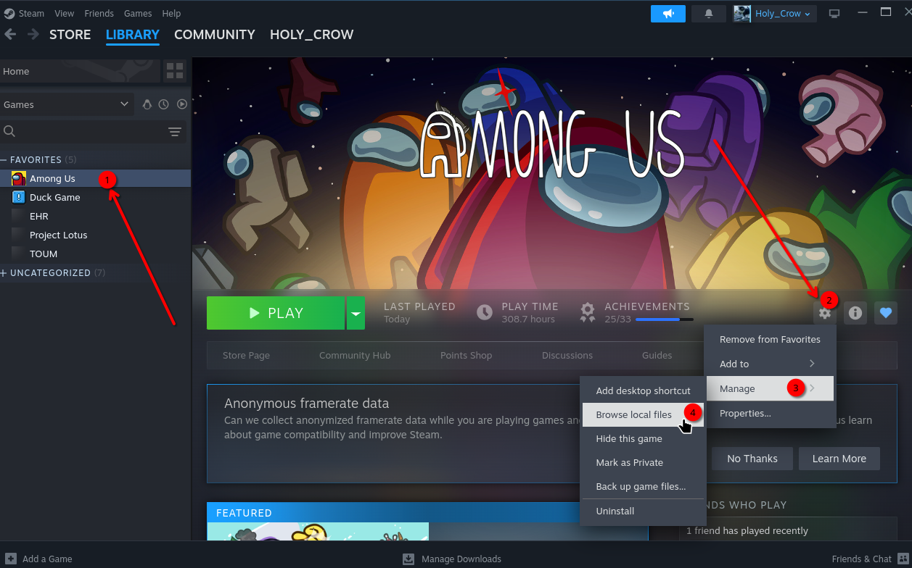
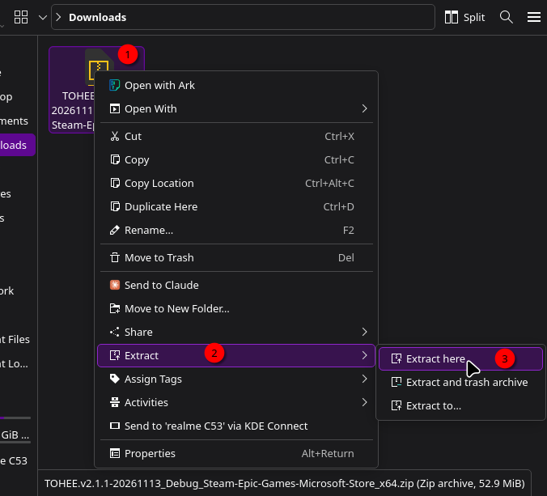
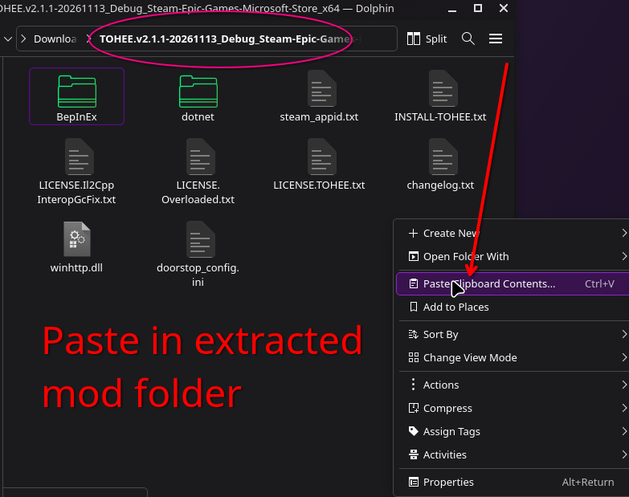
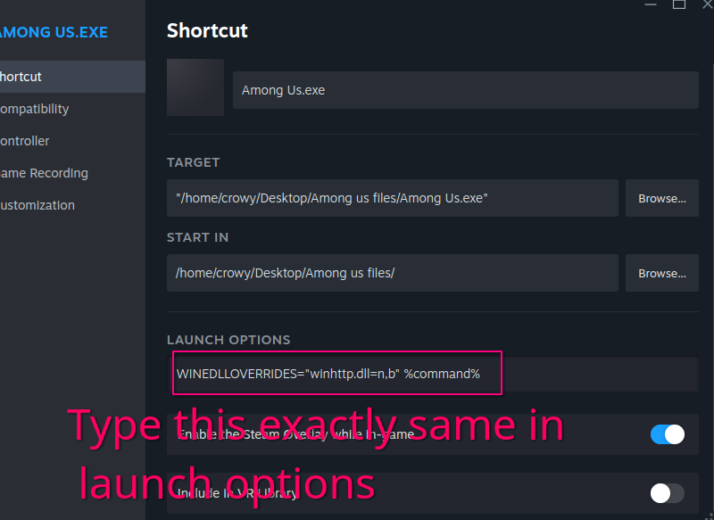
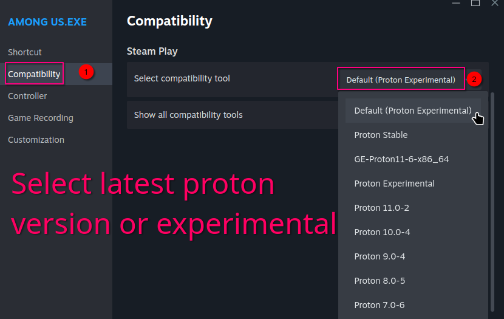

---
{
  "id": "guide-installation",
  "kind": "guide",
  "category": "guide",
  "title": {
    "zh-CN": "安装 TOHEE",
    "en": "Install TOHEE"
  },
  "summary": {
    "zh-CN": "下载正确的发行包，并将模组文件安装到 Among Us 游戏目录。",
    "en": "Download the correct release package and install its files beside Among Us."
  },
  "source": "https://github.com/AmongLLM/TownofHost-Enhanced-Enhanced/blob/1dcecb4481a07eeeb61df99415318ed5355339c7/packaging/INSTALL.txt",
  "order": 2
}
---
<!-- zh-CN -->
## 准备工作

- 需要 Windows 电脑、已安装的正版 Among Us，以及对应商店版本的游戏目录。TOHEE 是房主专属模组：房主需在电脑上安装，其他玩家不需要安装。
- 从 [TOHEE GitHub Releases](https://github.com/AmongLLM/TownofHost-Enhanced-Enhanced/releases) 下载最新发行包。不要下载源码 ZIP；源码包不是可直接运行的模组。
- 关闭 Among Us 后再安装或更新。若游戏目录已经装有其他模组或加载器，建议先准备一份干净的游戏副本，避免混用插件和 BepInEx 文件。

## 选择发行包架构

当前发行说明规定：Steam、Epic Games 和 Microsoft Store / Xbox App 版本使用 x64 包；Windows itch.io 版本使用 x86 包。itch.io 购买通常会提供 Steam Key；若你实际从 Steam 启动，请按 Steam 版本选择 x64 包。每次下载前都应查看该版本的发行说明，以确认架构与游戏版本要求。

## 安装步骤

1. 在 Steam、Epic Games、Xbox App 或 itch.io 客户端中找到 Among Us 的安装目录。目录内应有 `Among Us.exe`。
2. 关闭游戏，将发行压缩包中的**全部文件**解压到 `Among Us.exe` 所在目录。确认 `BepInEx` 等文件夹与游戏可执行文件处于同一层级；不要只复制 `TOHE.dll` 来首次安装。
3. 按下方商店差异选择启动方式，并等待首次加载完成。BepInEx 首次启动会为这份游戏安装生成 interop 文件，可能需要联网下载组件，首次启动会比平常更久。
4. 某些加载器或插件版本在首次初始化时可能需要重新启动；按你下载的发行包说明操作。
5. 检查主菜单或模组版本提示，确认 TOHEE 已加载；然后按[房间设置指南](/docs/guide-setup)创建房间。

发行包包含模组和加载器，不包含 Among Us 本体。不要把其他商店安装生成的 `interop` 目录复制到此目录；不同游戏安装应各自生成自己的文件。

## 商店差异

- **Steam：** 将文件放入 Steam 库中 Among Us 的游戏目录。可以从 Steam 启动，也可以直接运行该目录中的 `Among Us.exe`；登录时需要保持已登录的 Steam 客户端在后台运行。包内的 `steam_appid.txt` 供 Steam 使用。
- **Epic Games：** 使用 Epic 安装目录，并通过 Epic Games Launcher 启动游戏才能登录；直接运行 `Among Us.exe` 无法完成登录。
- **Xbox App / Microsoft Store：** 使用游戏目录中的 `Among Us.exe` 所在位置，选择 x64 发行包。此说明针对 Windows PC 游戏版本，不适用于 Xbox 主机。
- **itch.io：** 仅 Windows itch.io 客户端使用 x86 包。若 itch.io 提供的是 Steam Key 并通过 Steam 安装游戏，则改用 Steam 的 x64 包。

手机、平板和游戏主机不能安装这个 Windows 模组，但可以在版本兼容时加入由 TOHEE 房主创建的房间。旧版上游页面中提到的第三方 Mod Manager 安装步骤不属于当前推荐安装流程；请以 GitHub Releases 中的当前发行包及发行说明为准。

如果模组没有加载，请先核对游戏目录、架构和首次启动日志，再看[故障排查](/docs/guide-troubleshooting)。

<!-- en -->
## Before you start

- You need a PC, a legitimate installation of Among Us, and the game directory for the store version you use. TOHEE is host-only: the host installs it on a PC; other players do not need to install the mod.
- Download the latest release package from [TOHEE GitHub Releases](https://github.com/AmongLLM/TownofHost-Enhanced-Enhanced/releases). Do not download the source ZIP; it is not a runnable mod package.
- Close Among Us before installing or updating. If the game directory already contains another mod or loader, prepare a clean game copy to avoid mixing plugins and BepInEx files.

## Choose the package architecture

There are two install packages
- x64 for steam, epic games and microsoft/xbox
- x86 for Itch.io
  -# Itch can sometimes provide a steam key so if you use that and download the steam version make sure to use the x64 zip not x86.

## Windows install

1. Find Among Us in Steam, Epic Games, Xbox App, or itch.io and open its installation directory. It should contain `Among Us.exe`.
2.
- If you are on Epic Games or the xbox app/microsoft store close the game and extract **all files** from the release archive into the directory containing `Among Us.exe`. Keep folders such as `BepInEx` beside the game executable; do not install for the first time by copying only `TOHE.dll`.
- If you are on Steam or Itch.io close the game, extract the release archive to a folder of your choosing outside the installation directory and then copy **all** the files from the installation directory to said archive, make sure both `Among us.exe` and `BepInEx` are beside eachother; do not install for the first time by copying only `TOHE.dll`.
3. Launch the game using the method described in the store-specific notes below, then wait for the first load to finish. BepInEx generates interop files for this particular game installation on first launch and may need an internet connection to download components.
4. Some loader or plugin versions may require a restart during first initialization; follow the instructions for the release package you downloaded.
5. Check the main menu or mod version notice to confirm TOHEE loaded, then follow the [room setup guide](/docs/guide-setup).

The release package contains the mod and loader, not the Among Us game. Do not copy an `interop` directory generated by another store installation; each game installation must generate its own files.

## Linux install (steam)

1. Find Among Us in Steam and open its installation directory. It should contain `Among Us.exe`.
   
2. Extract the release archive to a folder of your choosing outside the installation directory and then copy **all** the files from the installation directory to said archive, make sure both `Among us.exe` and `BepInEx` are beside eachother; do not install for the first time by copying only `TOHE.dll`.
   

   

   
3. Open your steam library and click Add a game -> Add a non-steam game -> Browse -> and select the `Among us.exe` thats in your mod folder from step 2.
   

   
4. Find the new game entry in your steam library then open the game specific properties ( ⚙️ -> Properties ) and under launch options add `WINEDLLOVERRIDES="winhttp.dll=n,b" %command%`
   

   
5. Then go to the compatibility tab and make sure to select `Proton experimental`
   
6. Launch the game from steam, launching from `Among us.exe` will not work.
7. Some loader or plugin versions may require a restart during first initialization, if the game crashes restart and it should work on the second launch.
8. Check the main menu or mod version notice to confirm TOHEE loaded, then follow the [room setup guide](/docs/guide-setup).

## Store-specific notes

- **Steam:** For windows run `Among Us.exe` directly, but the signed-in Steam client must remain running in the background for game sign-in. The package includes `steam_appid.txt` for Steam.
- **Epic Games:** Use the Epic installation directory and launch the game through Epic Games Launcher to sign in. Running `Among Us.exe` directly does not complete sign-in.
- **Xbox App / Microsoft Store:** Use the directory containing that PC game's `Among Us.exe` and choose the x64 release package. This applies to the Windows PC game, not an Xbox console.
- **itch.io:** Use the x86 package only for the Windows itch.io client. If itch.io supplied a Steam key and you installed through Steam, use the Steam x64 package instead.

Phones, tablets, and consoles cannot install this Windows mod, but may join a TOHE-hosted room when the game versions are compatible.

If the mod does not load, first check the game directory, architecture, and first-launch log, then see [troubleshooting](/docs/guide-troubleshooting).
