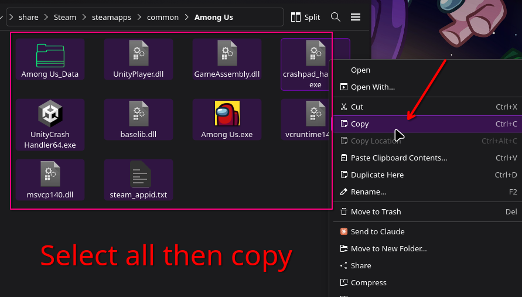
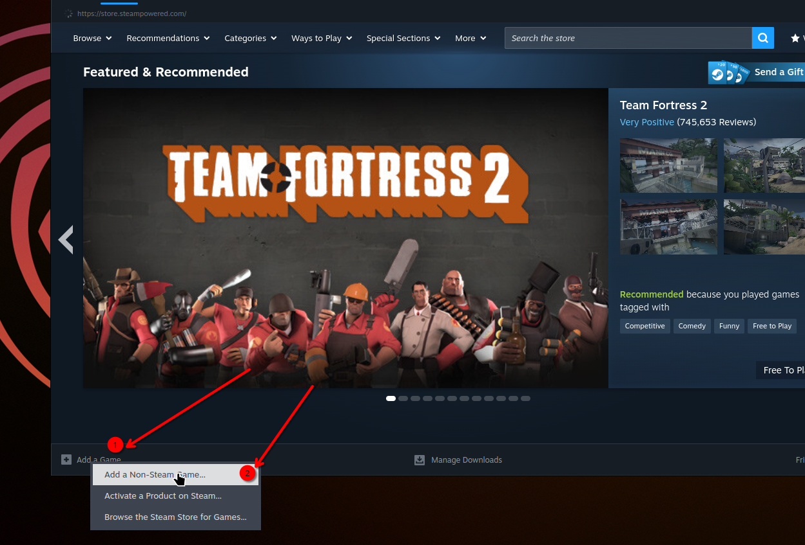
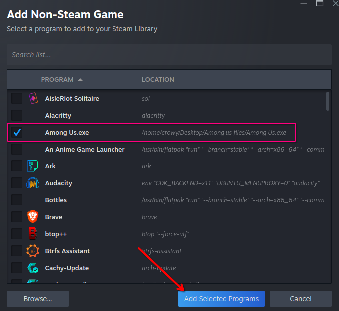
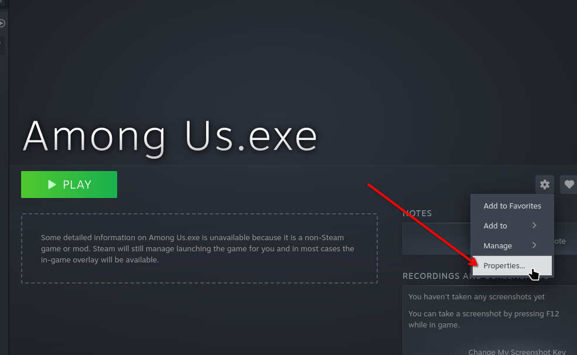

---
{
  "id": "guide-installation",
  "kind": "guide",
  "category": "guide",
  "title": {
    "zh-CN": "安装 TOHEE",
    "en": "Install TOHEE"
  },
  "summary": {
    "zh-CN": "下载正确的发行包，并将模组文件安装到 Among Us 游戏目录。",
    "en": "Download the correct release package and install its files beside Among Us."
  },
  "source": "https://github.com/AmongLLM/TownofHost-Enhanced-Enhanced/blob/1dcecb4481a07eeeb61df99415318ed5355339c7/packaging/INSTALL.txt",
  "order": 2
}
---
<!-- zh-CN -->
## 准备工作

- 需要 Windows 电脑，或通过 Steam 和 Proton 运行游戏的 Linux 电脑，以及已安装的正版 Among Us。TOHEE 是房主专属模组：房主需在电脑上安装，其他玩家不需要安装。
- 从 [TOHEE GitHub Releases](https://github.com/AmongLLM/TownofHost-Enhanced-Enhanced/releases) 下载最新发行包。不要下载源码 ZIP；源码包不是可直接运行的模组。
- 关闭 Among Us 后再安装或更新。若游戏目录已经装有其他模组或加载器，建议先准备一份干净的游戏副本，避免混用插件和 BepInEx 文件。

## 选择发行包架构

- **x64：** Steam、Epic Games 和 Microsoft Store / Xbox App 版本。
- **x86：** Windows itch.io 客户端版本。

如果通过 itch.io 获得 Steam Key 并安装 Steam 版本，请使用 Steam 的 x64 包。每次下载前都应查看该版本的发行说明，确认架构与游戏版本要求。

## Windows 安装

1. 在 Steam、Epic Games、Xbox App 或 itch.io 客户端中找到 Among Us 的安装目录。目录内应有 `Among Us.exe`。
2. 按商店选择安装方式：

   - **Steam / itch.io：** 将发行压缩包的全部内容解压到原版游戏安装目录之外的独立目录。将原版安装目录中的全部游戏文件复制到这个模组目录，不要将整个游戏目录作为子文件夹放入其中。确认 `Among Us.exe` 与 `BepInEx` 位于同一层级；之后使用此独立副本运行模组。首次安装不要只复制 `TOHE.dll`。
   - **Epic Games / Microsoft Store / Xbox App：** 将发行压缩包中的全部文件解压到 `Among Us.exe` 所在目录。确认 `BepInEx` 等文件夹与游戏可执行文件处于同一层级；首次安装不要只复制 `TOHE.dll`。

3. 按下方商店差异选择启动方式，并等待首次加载完成。BepInEx 首次启动会为这份游戏安装生成 interop 文件，可能需要联网下载组件，首次启动会比平常更久。
4. 某些加载器或插件版本在首次初始化时可能需要重新启动；按你下载的发行包说明操作。
5. 检查主菜单或模组版本提示，确认 TOHEE 已加载；然后按[房间设置指南](/docs/guide-setup)创建房间。

发行包包含模组和加载器，不包含 Among Us 本体。不要把其他商店安装生成的 `interop` 目录复制到此目录；不同游戏安装应各自生成自己的文件。

## Linux 安装（Steam）

1. 在 Steam 中找到 Windows 版 Among Us 的安装目录，确认其中有 `Among Us.exe`。

   

2. 下载正确架构的发行包，将全部内容解压到原版游戏安装目录之外的独立目录。将原版安装目录中的全部游戏文件复制到这个模组目录，不要将整个游戏目录作为子文件夹放入其中。确认 `Among Us.exe` 与 `BepInEx` 位于同一层级；首次安装不要只复制 `TOHE.dll`。

   

   

   

3. 在 Steam 库中选择“添加游戏”→“添加非 Steam 游戏”→“浏览”，选中上一步模组目录中的 `Among Us.exe`，然后在添加游戏窗口中确认选中它并选择“添加所选程序”。

   

   

4. 在 Steam 库中找到新游戏条目，选择齿轮图标 →“属性”，在启动选项中填入：

   ```bash
   WINEDLLOVERRIDES="winhttp.dll=n,b" %command%
   ```

   

   

5. 在“兼容性”选项卡中启用强制使用特定 Steam Play 兼容性工具，并选择 `Proton Experimental`。截图中还列出了其他版本，请选择 `Proton Experimental`。

   

6. 从 Steam 启动刚添加的独立游戏条目，而不是原版 Among Us 条目。
7. 某些加载器或插件版本在首次初始化时可能需要重新启动。如果首次启动崩溃，请尝试再次启动；如果问题仍然存在，请参阅[故障排查](/docs/guide-troubleshooting)。
8. 检查主菜单或模组版本提示，确认 TOHEE 已加载；然后按[房间设置指南](/docs/guide-setup)创建房间。

发行包包含模组和加载器，不包含 Among Us 本体。BepInEx 首次启动会为这份游戏安装生成 interop 文件，可能需要联网下载组件，首次启动会比平常更久。不要混用其他游戏安装生成的 `interop` 目录。

## 商店差异

- **Steam：** 在 Windows 上，使用上面推荐的独立副本安装方式后，可以直接运行该副本中的 `Among Us.exe`。游戏登录时需保持已登录的 Steam 客户端在后台运行。包内的 `steam_appid.txt` 供 Steam 使用。
- **Epic Games：** 使用 Epic 安装目录，并通过 Epic Games Launcher 启动游戏才能登录；直接运行 `Among Us.exe` 无法完成登录。
- **Xbox App / Microsoft Store：** 使用游戏目录中的 `Among Us.exe` 所在位置，选择 x64 发行包。此说明针对 Windows PC 游戏版本，不适用于 Xbox 主机。
- **itch.io：** 仅 Windows itch.io 客户端使用 x86 包。若 itch.io 提供的是 Steam Key 并通过 Steam 安装游戏，则改用 Steam 的 x64 包。

手机、平板和游戏主机不能安装这个 PC 模组，但可以在版本兼容时加入由 TOHEE 房主创建的房间。旧版上游页面中提到的第三方 Mod Manager 安装步骤不属于当前推荐安装流程；请以 GitHub Releases 中的当前发行包及发行说明为准。

如果模组没有加载，请先核对游戏目录、架构和首次启动日志，再看[故障排查](/docs/guide-troubleshooting)。

<!-- en -->
## Before you start

- You need a Windows PC, or a Linux PC running the game through Steam and Proton, and a legitimate installation of Among Us. TOHEE is host-only: the host installs it on a PC; other players do not need to install the mod.
- Download the latest release package from [TOHEE GitHub Releases](https://github.com/AmongLLM/TownofHost-Enhanced-Enhanced/releases). Do not download the source ZIP; it is not a runnable mod package.
- Close Among Us before installing or updating. If the game directory already contains another mod or loader, prepare a clean game copy to avoid mixing plugins and BepInEx files.

## Choose the package architecture

- **x64:** Steam, Epic Games, and Microsoft Store / Xbox App versions.
- **x86:** Windows itch.io client.

If your itch.io purchase provides a Steam key and you install the Steam version, use the x64 Steam package. Check each release's notes for its game-version and architecture requirements before downloading.

## Windows install

1. Find Among Us in Steam, Epic Games, Xbox App, or itch.io and open its installation directory. It should contain `Among Us.exe`.
2. Install the mod using the appropriate method:

   - **Steam / itch.io:** Extract all files from the release archive to a separate directory outside the original game installation. Copy all game files from the original installation directory into this mod directory; do not place the entire game directory inside it as a subfolder. Confirm that `Among Us.exe` and `BepInEx` are at the same level, then use this separate copy to run the mod. Do not install for the first time by copying only `TOHE.dll`.
   - **Epic Games / Microsoft Store / Xbox App:** Extract **all files** from the release archive into the directory containing `Among Us.exe`. Keep folders such as `BepInEx` beside the game executable; do not install for the first time by copying only `TOHE.dll`.

3. Launch the game using the method described in the store-specific notes below, then wait for the first load to finish. BepInEx generates interop files for this particular game installation on first launch and may need an internet connection to download components.
4. Some loader or plugin versions may require a restart during first initialization; follow the instructions for the release package you downloaded.
5. Check the main menu or mod version notice to confirm TOHEE loaded, then follow the [room setup guide](/docs/guide-setup).

The release package contains the mod and loader, not the Among Us game. Do not copy an `interop` directory generated by another store installation; each game installation must generate its own files.

## Linux install (Steam)

1. Find the Windows version of Among Us in Steam and open its installation directory. It should contain `Among Us.exe`.

   

2. Download the release package for the correct architecture and extract all its files to a separate directory outside the original game installation. Copy all game files from the original installation directory into this mod directory; do not place the entire game directory inside it as a subfolder. Confirm that `Among Us.exe` and `BepInEx` are at the same level. Do not install for the first time by copying only `TOHE.dll`.

   

   

   

3. In your Steam library, select Add a Game → Add a Non-Steam Game → Browse, then select `Among Us.exe` in the mod directory from step 2. In the Add a Game dialog, confirm it is checked and select Add Selected Programs.

   

   

4. Find the new game entry in your Steam library, select the gear icon → Properties, and enter the following under Launch Options:

   ```bash
   WINEDLLOVERRIDES="winhttp.dll=n,b" %command%
   ```

   

   

5. On the Compatibility tab, enable the option to force the use of a specific Steam Play compatibility tool, then select `Proton Experimental`. The screenshot also lists other versions; select `Proton Experimental`.

   

6. Launch the separate game entry you added to Steam, rather than the original Among Us entry.
7. Some loader or plugin versions may require a restart during first-time initialization. If the game crashes on the first launch, try launching it again. If the problem persists, refer to [troubleshooting](/docs/guide-troubleshooting).
8. Check the main menu or mod version notice to confirm TOHEE loaded, then follow the [room setup guide](/docs/guide-setup).

The release package contains the mod and loader, not the Among Us game. BepInEx generates interop files for this game installation on first launch and may need an internet connection to download components, so the first launch may take longer. Do not mix in an `interop` directory generated by another game installation.

## Store-specific notes

- **Steam:** On Windows, after installing into the recommended separate game copy, you can run that copy's `Among Us.exe` directly. The signed-in Steam client must remain running in the background for game sign-in. The package includes `steam_appid.txt` for Steam.
- **Epic Games:** Use the Epic installation directory and launch the game through Epic Games Launcher to sign in. Running `Among Us.exe` directly does not complete sign-in.
- **Xbox App / Microsoft Store:** Use the directory containing that PC game's `Among Us.exe` and choose the x64 release package. This applies to the Windows PC game, not an Xbox console.
- **itch.io:** Use the x86 package only for the Windows itch.io client. If itch.io supplied a Steam key and you installed through Steam, use the Steam x64 package instead.

Phones, tablets, and consoles cannot install this PC mod, but may join a TOHE-hosted room when the game versions are compatible. Third-party Mod Manager installation steps on old upstream pages are not the current recommended installation flow; follow the current GitHub release package and its notes.

If the mod does not load, first check the game directory, architecture, and first-launch log, then see [troubleshooting](/docs/guide-troubleshooting).
